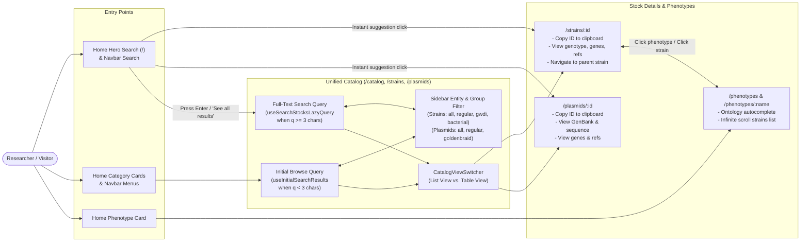
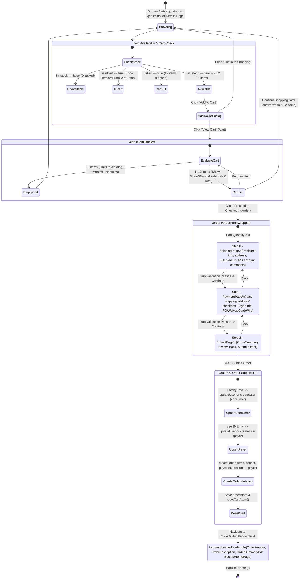
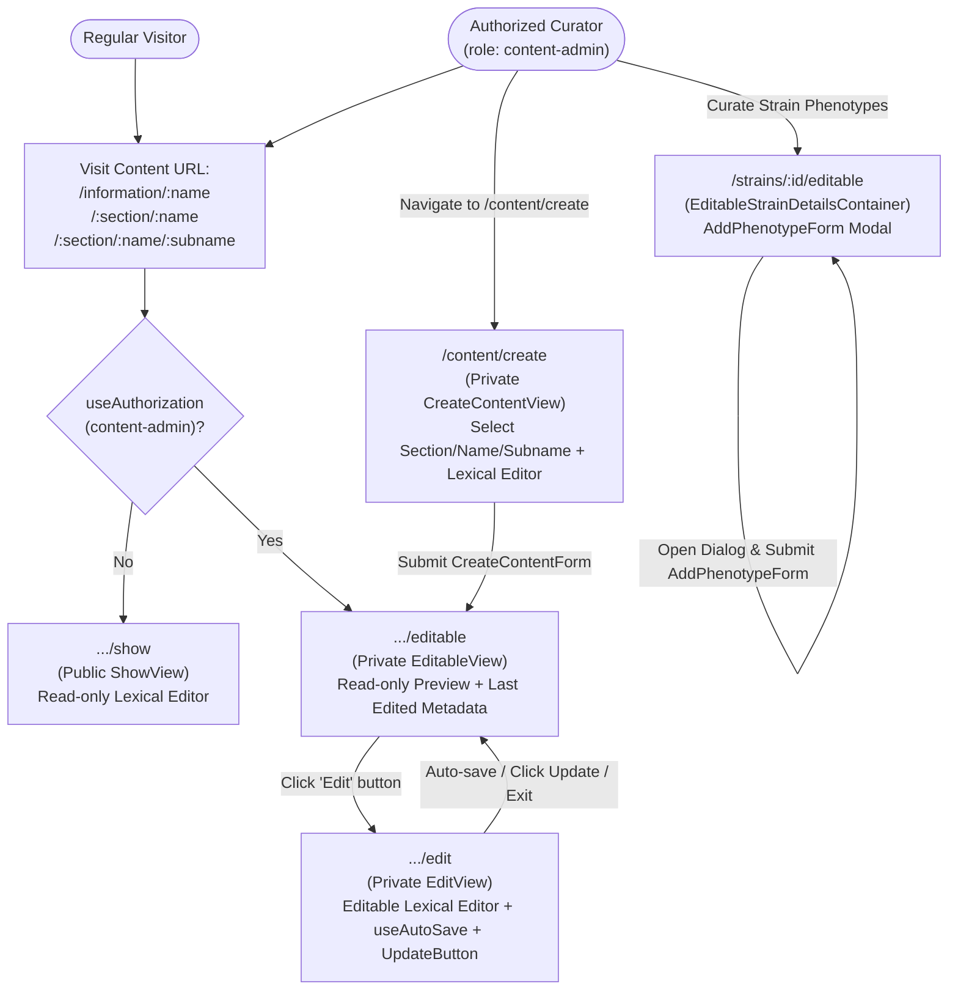

# Dicty Stock Center: Routes & User Stories

This document maps the routes, navigation flows, access boundaries, and user stories across the **Dicty Stock Center (`apps/stock-center`)** application.

---

## 1. End-to-End Route & User Story Map

```mermaid
flowchart TD
  %% Styling
  classDef publicRoute fill:#e3f2fd,stroke:#1565c0,stroke-width:2px,color:#0d47a1
  classDef protectedRoute fill:#fff8e1,stroke:#f57f17,stroke-width:2px,color:#e65100
  classDef privateRoute fill:#fce4ec,stroke:#c2185b,stroke-width:2px,color:#880e4f
  classDef stateNode fill:#ede7f6,stroke:#5e35b1,stroke-width:2px,stroke-dasharray: 5 5,color:#311b92
  classDef layoutNode fill:#263238,stroke:#000000,stroke-width:2px,color:#ffffff

  Navbar["DscNavbar Layout Wrapper<br/>(Brand, Mega-Menus, Contextual Search, Cart Badge, Auth)"]:::layoutNode

  %% 1. Landing & Global Search
  subgraph Discovery["1. Landing & Global Discovery (Public)"]
    Home["/ (NewHome)<br/>GeneralSearch, OrderingSteps,<br/>CatalogCards, StatsBanner,<br/>PhenotypeSearchCard, Resources"]:::publicRoute
    SuggestDropdown(["Live Suggestions Dropdown<br/>(useComprehensiveSearch)" ]):::stateNode
  end

  %% 2. Catalogs & Stock Details
  subgraph CatalogAndDetails["2. Catalog Browsing, Search & Stock Details"]
    Catalog["/catalog?q=&group=<br/>(CatalogSearch entity='all')<br/>List / Table View Switcher"]:::publicRoute
    StrainCatalog["/strains?q=&group=all|regular|gwdi|bacterial<br/>(StrainCatalogPage)"]:::publicRoute
    PlasmidCatalog["/plasmids?q=&group=all|regular|goldenbraid<br/>(PlasmidCatalogPage)"]:::publicRoute

    StrainDetails["/strains/:id<br/>(StrainDetailsContainer)<br/>Tab 0: Details | Tab 1: Phenotypes"]:::publicRoute
    StrainEditable["/strains/:id/editable<br/>(EditableStrainDetailsContainer)<br/>+ AddPhenotypeForm Dialog"]:::privateRoute
    PlasmidDetails["/plasmids/:id<br/>(PlasmidDetailsContainer)<br/>Details, Sequence & Cart Action"]:::publicRoute

    PhenotypeIndex["/phenotypes<br/>(SearchPhenotypeContainer)<br/>Ontology Autocomplete"]:::publicRoute
    PhenotypeResults["/phenotypes/:name<br/>(SearchPhenotypeContainer)<br/>Paginated Strain Results"]:::publicRoute
  end

  %% 3. Shopping Cart & Order Flow
  subgraph ECommerce["3. Shopping Cart & Multi-Step Order Flow (Public)"]
    AddToCartModal(["AddToCartButtonHandler & Dialog<br/>(Max 12 items / isFullAtom)"]):::stateNode
    Cart["/cart<br/>(CartHandler)"]:::publicRoute
    EmptyCartView(["EmptyCart View"]):::stateNode
    CartListView(["CartList View<br/>(Strain/Plasmid Items & Totals)"]):::stateNode

    OrderGuard{"Cart Quantity > 0?<br/>(OrderFormWrapper)"}:::stateNode
    OrderShipping["/order (Step 0: ShippingPage)<br/>Address, Courier Account, Comments"]:::publicRoute
    OrderPayment["/order (Step 1: PaymentPage)<br/>Payer Address, PO / Waiver / Card / Wire"]:::publicRoute
    OrderSubmit["/order (Step 2: SubmitPage)<br/>OrderSummary & SubmitButton"]:::publicRoute
    OrderConfirmed["/order/submitted/:orderId<br/>(OrderConfirmation & PDF Summary)"]:::publicRoute
  end

  %% 4. Auth & User Profile
  subgraph AuthAndUser["4. Authentication & User Profile"]
    Login["/login (Login)"]:::publicRoute
    Callback["/callback (Callback)"]:::publicRoute
    Unauthorized["/unauthorized (UnAuthorized)"]:::publicRoute
    UserShow["/user/show<br/>(Profile, Info & EditablePagesList)"]:::protectedRoute
    UserEdit["/user/edit<br/>(Edit User)"]:::protectedRoute
  end

  %% 5. Information & Content Management (CMS)
  subgraph CMS["5. Information Pages & CMS (dsc & dicty-frontpage namespaces)"]
    SopShow["/information/sop/show<br/>(Sop PDF Viewer & Download)"]:::publicRoute
    ContentRedirect["/information/:name<br/>/:section/:name<br/>/:section/:name/:subname<br/>(RoleRedirect)"]:::publicRoute
    ContentShow[".../show<br/>(Read-Only Lexical ShowView)"]:::publicRoute
    ContentEditable[".../editable<br/>(EditableView + Edit ActionBar)"]:::privateRoute
    ContentEdit[".../edit<br/>(EditView + Lexical AutoSave)"]:::privateRoute
    ContentCreate["/content/create<br/>(CreateContentView + CreateContentForm)"]:::privateRoute
    ContentNotFound[".../notfound & .../notfoundauth"]:::publicRoute
  end

  %% Global Navbar Connections
  Navbar -->|"Logo"| Home
  Navbar -->|"Cart Icon Badge"| Cart
  Navbar -->|"Contextual Search (non-search pages)"| SuggestDropdown
  Navbar -->|"Mega-Menu Links"| Catalog
  Navbar -->|"Mega-Menu Links"| SopShow
  Navbar -->|"Mega-Menu Links"| ContentShow
  Navbar -->|"Sign In"| Login

  %% Discovery Connections
  Home -->|"Type >= 3 chars"| SuggestDropdown
  SuggestDropdown -->|"Select Strain"| StrainDetails
  SuggestDropdown -->|"Select Plasmid"| PlasmidDetails
  SuggestDropdown -->|"Enter / See all results"| Catalog
  Home -->|"Full Catalog Card"| Catalog
  Home -->|"Strain / GWDI / Bacterial Links"| StrainCatalog
  Home -->|"Plasmid / GoldenBraid Links"| PlasmidCatalog
  Home -->|"Explore Strains by Phenotype"| PhenotypeIndex
  Home -->|"Ordering Steps / Resources Links"| ContentRedirect

  %% Catalog & Details Connections
  Catalog <-->|"Sidebar Entity Switcher (preserves ?q=)"| StrainCatalog
  Catalog <-->|"Sidebar Entity Switcher (preserves ?q=)"| PlasmidCatalog
  StrainCatalog <-->|"Sidebar Entity Switcher"| PlasmidCatalog

  Catalog -->|"Select Strain"| StrainDetails
  Catalog -->|"Select Plasmid"| PlasmidDetails
  StrainCatalog -->|"Select Strain"| StrainDetails
  PlasmidCatalog -->|"Select Plasmid"| PlasmidDetails

  StrainDetails -->|"Parental Strain Link"| StrainDetails
  StrainDetails -->|"Phenotype Tab Link"| PhenotypeResults
  StrainEditable -->|"Add Phenotype Mutation"| StrainEditable
  PhenotypeIndex -->|"Autocomplete Select / Search"| PhenotypeResults
  PhenotypeResults -->|"Select Strain"| StrainDetails

  %% Cart & Order Connections
  Catalog -->|"In-Stock Item Action"| AddToCartModal
  StrainCatalog -->|"In-Stock Item Action"| AddToCartModal
  PlasmidCatalog -->|"In-Stock Item Action"| AddToCartModal
  StrainDetails -->|"Add to Cart"| AddToCartModal
  PlasmidDetails -->|"Add to Cart"| AddToCartModal

  AddToCartModal -->|"View Cart"| Cart
  Cart -->|"0 items"| EmptyCartView
  Cart -->|"1..12 items"| CartListView
  EmptyCartView -->|"Browse Catalogs"| Catalog
  EmptyCartView -->|"Browse Strains"| StrainCatalog
  EmptyCartView -->|"Browse Plasmids"| PlasmidCatalog
  CartListView -->|"ContinueShoppingCard (< 12 items)"| Catalog
  CartListView -->|"Proceed to Checkout"| OrderGuard

  OrderGuard -->|"Empty (0 items)"| Cart
  OrderGuard -->|"Has Items"| OrderShipping
  OrderShipping -->|"Valid Form + Continue"| OrderPayment
  OrderPayment -->|"Back"| OrderShipping
  OrderPayment -->|"Valid Form + Continue"| OrderSubmit
  OrderSubmit -->|"Back"| OrderPayment
  OrderSubmit -->|"Submit Order (Upsert Users + CreateOrder + Empty Cart)"| OrderConfirmed
  OrderConfirmed -->|"Mismatch orderID or Back to Home"| Home

  %% Auth Connections
  Login -->|"Logto Auth"| Callback
  Callback -->|"Redirect"| Home

  %% CMS Connections
  ContentRedirect -->|"Unauthenticated / Regular User"| ContentShow
  ContentRedirect -->|"Authorized (content-admin)"| ContentEditable
  ContentEditable -->|"Click Edit"| ContentEdit
  ContentEdit -->|"Save / Exit"| ContentEditable
  ContentCreate -->|"Create Mutation Success"| ContentEditable
```

All routes are mounted under the root `<DscNavbar />` layout (`apps/stock-center/src/routes.tsx`, basename `VITE_APP_BASENAME`, typically `/stockcenter`) with `<NotFoundError />` as the root error boundary and route-level access control managed by `@dictybase/auth-mui5`.

> **Legend:**
> - **Blue (`public`)**: Accessible to all visitors.
> - **Yellow (`protected`)**: Requires an authenticated Logto session (`<Protected />`).
> - **Pink (`private` / `content-admin`)**: Requires authentication + `content-admin` role (`<Private roles={["content-admin"]} />`) or curator access.
> - **Purple Dashed**: Conditional UI states, modals, or route guards driven by Jotai atoms / hooks.

---

## 2. Detailed User Story Flows by Domain

### A. Catalog Discovery, Search & Phenotype Exploration

### B. Shopping Cart & Checkout User Story Flow

### C. Content Management (CMS) & Curation User Story Flow

---

## 3. Complete Route & User Story Reference Table

| Route Pattern | Source File (`apps/stock-center/src/pages/...`) | Access Level | Primary Component | User Stories Supported |
| :--- | :--- | :--- | :--- | :--- |
| **`/`** | `index.tsx` | `public` | `NewHome` | • As a researcher, I can search across all strains and plasmids from the hero search bar with instant typeahead suggestions. • As a new visitor, I can expand "How to place an order" to understand the 5-step ordering workflow. • As a visitor, I can jump directly to filtered catalogs (`GWDI`, `Bacterial`, `GoldenBraid`), phenotype search, or informational guides. |
| **`/catalog`** | `catalog/index.tsx` | `public` | `CatalogSearch` (`entity="all"`) | • As a researcher, I can browse initial catalog items or perform a debounced full-text search (`?q=`, 3+ chars) across both strains and plasmids. • As a researcher, I can switch between **List View** and **Table View**. • As a researcher, I can filter by stock type/group (`?group=`) via the sidebar and add available items directly to my cart. |
| **`/strains`** | `strains/index.tsx` | `public` | `StrainCatalogPage` (`entity="strain"`) | • As a researcher, I can browse or search specifically within strains and filter by **All Strains**, **Regular Strains**, **GWDI Strains**, or **Bacterial Strains**. |
| **`/plasmids`** | `plasmids/index.tsx` | `public` | `PlasmidCatalogPage` (`entity="plasmid"`) | • As a researcher, I can browse or search specifically within plasmids and filter by **All Plasmids**, **Regular Plasmids**, or **Golden Braid Plasmids**. |
| **`/strains/:id`** | `strains/[id]/index.tsx` | `public` | `StrainDetailsContainer` | • As a researcher, I can inspect a strain's descriptor, names, summary, systematic name, characteristics, genetic modification, mutagenesis method, parental strain (linked), plasmid, associated genes, genotype, species, depositor, and publications. • As a researcher, I can copy the strain ID to my clipboard, switch to the **Phenotypes** tab, and add/remove the strain from my cart. |
| **`/strains/:id/editable`** | `strains/[id]/editable.tsx` | `public` *(Curator UI)* | `EditableStrainDetailsContainer` | • As a curator, I can view strain details and use the **Add Phenotype** dialog (`AddPhenotypeForm`) to attach new phenotype annotations (phenotype ontology term, assay, environment, note, publication reference) to a strain. |
| **`/plasmids/:id`** | `plasmids/[id]/index.tsx` | `public` | `PlasmidDetailsContainer` | • As a researcher, I can view a plasmid's descriptor, summary, GenBank accession number, depositor, associated genes, sequence (`PlasmidSequenceDisplay`), and publications, and add/remove the plasmid from my cart. |
| **`/phenotypes`** **`/phenotypes/:name`** | `phenotypes/index.tsx` `phenotypes/[name].tsx` | `public` | `SearchPhenotypeContainer` | • As a researcher, I can search for a phenotype using Dicty Phenotype Ontology autocomplete (`SearchPhenotypeForm`). • As a researcher, I can browse an infinite-scrolling list of all strains annotated with that phenotype, along with their associated genes and publications, and click through to `/strains/:id`. |
| **`/cart`** | `cart.tsx` | `public` | `CartHandler` | • As a researcher, I can review all strains and plasmids in my cart (persisted and broadcast across tabs via `atomWithBroadcast`, up to 12 items max). • As a researcher, I can see itemized fees, strain/plasmid subtotals, and the cumulative total, remove individual items, continue shopping, or proceed to checkout. |
| **`/order`** | `order/index.tsx` | `public` *(Guarded)* | `OrderFormWrapper` | • As a researcher with items in my cart (redirects to `/cart` if empty), I can complete a 3-step checkout:   1. **Shipping (`ShippingPage`)**: Enter recipient contact/address, courier (`DHL`/`FedEx`/`UPS`) & account number, and comments.   2. **Payment (`PaymentPage`)**: Optionally copy the shipping address, enter payer info, and select payment method (`purchaseOrder`, `waiver`, `credit`, `wire`).   3. **Review & Submit (`SubmitPage`)**: Review the full order summary and submit the order. |
| **`/order/submitted/:orderId`** | `order/submitted/[orderId].tsx` | `public` *(Guarded)* | `OrderConfirmation` | • As a purchaser who just submitted an order (redirects to `/` if `:orderId` doesn't match `orderAtom`), I can view my confirmation number, read processing instructions, view/download a PDF summary (`OrderSummaryPdf`), and return home. |
| **`/information/sop/show`** | `information/sop/show.tsx` | `public` | `Sop` | • As a researcher, I can view the embedded Standard Operating Procedures PDF (`DSC_SOP_OIM_Aug22.pdf`) in-browser or download a copy. |
| **`/information/:name`** **`/:section/:name`** **`/:section/:name/:subname`** | `information/[name]/index.tsx` `[section]/[name]/index.tsx` `[section]/[name]/[subname]/index.tsx` | `public` | `RoleRedirect` | • Automatically routes visitors to `.../show` and authorized `content-admin` users to `.../editable`. |
| **`.../show`** | `.../show.tsx` | `public` | `Show` | • As a visitor, I can read rich-text CMS pages in the `dsc` namespace (`/information/order`, `deposit`, `payment`, `faq`, `additional-materials`) and `dicty-frontpage` namespace (`explore/*`, `research/*`, `community/*`). |
| **`.../editable`** **`.../edit`** | `.../editable.tsx` `.../edit.tsx` | `private` (`content-admin`) | `Editable` `Edit` | • As a `content-admin`, I can preview CMS pages with last-edited metadata (`EditableView`) and transition into `EditView` to edit rich text with Lexical, automatic background saving (`useAutoSave`), and manual save/exit controls. |
| **`/content/create`** | `content/create.tsx` | `private` (`content-admin`) | `CreateContentView` | • As a `content-admin`, I can author a new CMS page in the Lexical editor, select its target section/slug (`ContentPathInputs`), persist it via GraphQL, and be redirected to its `/editable` view. |
| **`/user/show`** **`/user/edit`** | `user/show.tsx` `user/edit.tsx` | `protected` | `Show` `Edit` | • As an authenticated user, I can view my user profile details and (if authorized as `content-admin`) see the list of editable pages (`EditablePagesList`). |
| **`/login`** **`/callback`** **`/unauthorized`** | `@dictybase/auth-mui5` `callback.tsx` | `public` | `Login` `Callback` `UnAuthorized` | • Handles Logto OIDC sign-in initiation, OAuth callback completion (redirecting to `/`), and unauthorized role fallback displays. |
